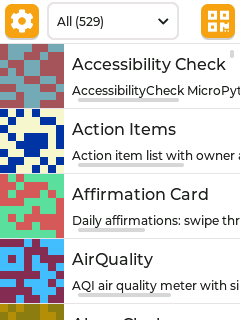
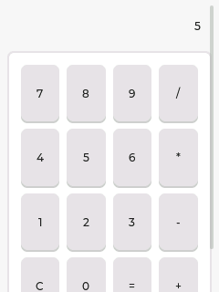
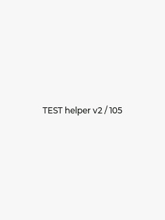

# AppStore upstream synchronization and D-Shell regression, 2026-11-20

This record covers the existing builtin AppStore integration with uPyStore,
after synchronizing the organization repository with official main. Earlier
dated reports retain the decisions and results observed at their own checkpoints.
The previous PR hold was lifted by the user's explicit submission instruction.

## Source preservation and merge

- Saved AppStore commit: `cc373d222be317e95eba8417b1351557ebf4c47f`.
- A backup branch and complete Git bundle preserve the pre-sync history.
- Official main synchronized: `2a6cd97a` (133 commits ahead of organization main).
- Organization main fast-forwarded without rewriting its existing history.
- Integration merge: `07057ed5c199deb6df4c246ea0228d0d7a397dd2`.
- Only CHANGELOG conflicted. The complete upstream log and AppStore entry were
  both retained. No application implementation was discarded or overwritten.
- All nine packaged AppStore files are unchanged by this merge. Rebuilding its
  MPK from the merged source gives the same bytes as the tested artifact.

## Retained behavior and protections

The existing AppStore identity and official list/detail UI remain. Categories,
icons/placeholders, Installed/Updates, version display, Open, Uninstall, Update,
Update All, Settings, boot checks and update notifications are retained.
Both foreground and background read the provider preference; background checks
ignore foreground search and compare revisions. This branch defaults to
uPyStore, with BadgeHub still selectable. It proposes that default explicitly;
it does not claim the official default has already changed.

Whole MPKs require expected size/SHA256, strict archive paths, a matching app
root and a declared valid main/launcher entry. Staged full-directory replacement
removes obsolete files and clears helpers cached from the final path. Install
success and actual Activity startup are checked separately. No malformed
publisher package is admitted by weakening the path validation.

## Hardware and actual scope

| Item | Value |
| --- | --- |
| Device | D-Shell ESP32-S3 N16R8; 240 x 320 ST7789V / GT911; 80 MHz display SPI |
| Device firmware | Existing MicroPythonOS 0.21.2 / API 0 |
| Merged source OS version | 0.22.1; full OS firmware was not flashed in this application regression |
| AppStore | 1.5.3, local unpublished revision 3, 34,071 bytes |
| MPK SHA256 | b436ce8aecb9502cdadfca08f07cb158e238aec64cc0f08bedcca0365f193e59 |
| Runtime identity | All nine device files match the MPK generated from merged source |
| Live store app | CC Skill Smoke 1.0.0 / revision 1, 3,872 bytes |
| Live MPK SHA256 | 44b63bb4af00613edea5ce01069aa58e3032a7dad81a7e350b263c35a75418b6 |

The regression exercises the AppStore payload on the connected board. It does
not claim a newly built or flashed complete 0.22.1 firmware. Headless native
MicroPython tests execute the merged Python framework with the available native
interpreter; they are not a full desktop OS preview.

## Regression execution

Merged-source CPython tests: **42 passed**. Native MicroPython: **130 passed**
across eight targeted suites. `make lint` and `make syntax-tests` passed.
The isolated syntax checkout initially lacked its mpy-cross path; pointing it
to the existing compiler resolved that tooling issue without source changes.

**25 new scoped physical-device records passed after synchronization.**
The [machine-readable records](assets/appstore-sync-20261120/device-results.json)
bind each result to the same verified MPK hash.

| New device regression | Actual result |
| --- | --- |
| Identity | All nine installed files match the merged-source MPK; original AppStore entry, no independent store. |
| Catalog/search/detail | Complete All list: 529 merged rows; Utilities: 384 rows; real search/detail/version controls and separate store App objects pass. |
| Whole-MPK install | Real HTTPS calculator download, size/SHA256, uninstall, reinstall, receipt and empty staging checks pass. |
| Separate launch | Actual CalculatorActivity button matrix yields 2 + 3 = 5; return/widget cleanup pass. |
| Helper upgrade | Both controlled apps execute v1/5 before Update All, then v2/105 without reset. Removed/renamed helper files and old module caches are absent. |
| Entry and notification | Invalid r3 main/launcher declaration rejected with v1 preserved; actual background notification opens original AppStore Updates. |
| Errors/recovery | Actual Wi-Fi loss/reconnect/reinstall, real wrong-expected-hash protection, controlled timeout and real obsolete-sample 404 prompts pass. |
| Final cleanup | Controlled apps uninstalled, transport restored, staging empty, real network/event loop alive and Launcher restored. |

The controlled fixture archive was initially absent because its earlier installer
had consumed it. Restoring the identical bundle resolved this harness setup
failure; it was not an application fix or a passed test. Original attempts remain
in the local serial evidence.

Earlier same-MPK manual confirmation is retained as earlier evidence, not
relabeled as a new recording. Screenshots are actual device RGB565 framebuffers
converted to PNG; none is presented as a camera video.

## Known limitations and follow-up

- During this rerun the live calculator chain completed, while the background
  request `https://upystore.io/api/v1/apps?limit=100&page=3&q=` timed out.
  Repeated background transport stability remains open; prior TLS -29312 and
  header parsing errors are retained in earlier evidence. One viewport icon
  request also timed out while the catalog/category flow remained usable.
- Helper upgrades use controlled local packages/metadata. A trusted app with
  two public uPyStore revisions is still needed for an online revision-upgrade
  case. This is not a prerequisite for proposing the tested client integration.
- Previously malformed Danke/Show Battery packages and obsolete/single-file
  404s remain publisher/API follow-ups. They do not negate the healthy whole-MPK
  path and are not silently fixed by weakening client checks.
- uPyStore rating writes lack a supplied contract; optional install/profile
  reporting is not enabled. The retained BadgeHub path remains selectable.
- This change does not claim every third-party app is compatible, a camera/QR
  acceptance run, or OTA verification. Those are outside this scoped AppStore PR.

## Reproduction

See [installation and package generation](../appstore-upystore.md) and
[controlled helper fixtures](../../tests/fixtures/appstore_upystore/README.md).

Organization branch:
https://github.com/FreakStudioCN/MicroPythonOS/tree/feature/appstore-upystore
